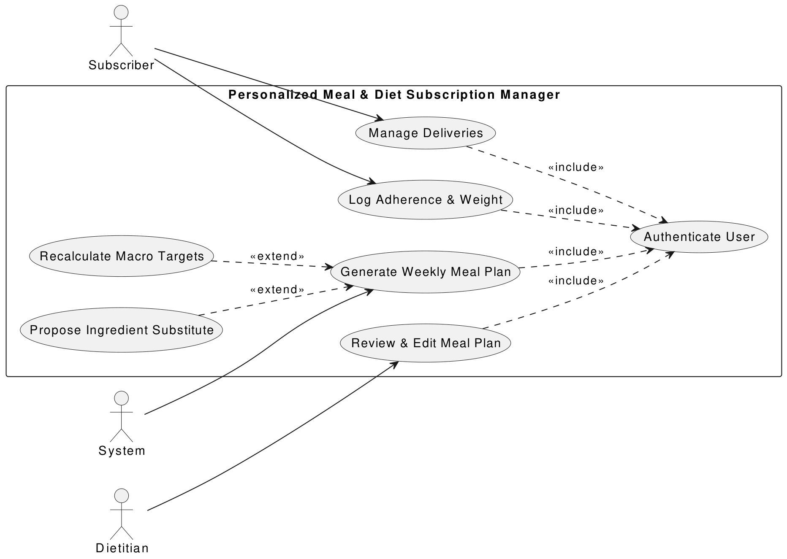
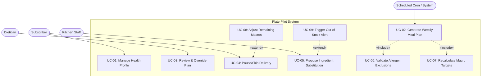

# Lab 1: Requirements Engineering & UML Use-Case Modelling
**Course:** Software Engineering (UE24CS351A)  
**Student SRN:** PES1UG24CS387  
**Problem Statement #19:** Healthcare & Telemedicine (Personalized Meal & Diet Subscription Manager — Plate Pilot)

---

## 1. Domain & Scenario Overview
The **Plate Pilot** system is an automated, medically tailored meal and diet subscription management platform designed for patients managing chronic conditions (e.g., diabetes, renal disease, severe food allergies) and wellness subscribers aiming for targeted macronutrient goals.

The system bridges clinical dietary requirements with daily food fulfillment, ensuring all generated menus respect rigorous allergen constraints, recalibrate adaptively based on biometric trends, and undergo clinical review by licensed dietitians.

---

## 2. Requirements Specification Table

Per the Lab 1 handout instructions, exactly five Functional Requirements (FRs) and two Non-Functional Requirements (NFRs) are specified:

| Req ID | Requirement Type | Description | Priority | Acceptance Criteria | Rationale |
| :--- | :--- | :--- | :--- | :--- | :--- |
| **FR-001** | Functional | The system shall generate weekly meal plans strictly adhering to user macronutrient constraints and allergen exclusion lists. | High | **Pass:** Generated menu contains zero excluded allergen ingredients.<br>**Fail:** Peanuts or listed allergen included for an allergic profile. | Core safety functionality preventing life-threatening allergic reactions and ensuring medical diet compliance. |
| **FR-002** | Functional | The system shall recalculate the subscriber's next week's macronutrient targets based on logged adherence and weight-trend data (adaptive recalibration). | High | **Pass:** Next week's macros are adjusted automatically based on previous week's logged weight and food intake.<br>**Fail:** Macros remain static despite logged changes. | Ensures the diet plan remains clinically effective and adapts dynamically to subscriber progress. |
| **FR-003** | Functional | The system shall allow an assigned Dietitian to review, edit, or override an auto-generated plan before it is dispatched to the subscriber. | Medium | **Pass:** Dietitian edits are saved and reflected in the user's dispatched plan.<br>**Fail:** Auto-generated plan is dispatched ignoring dietitian edits. | Provides professional clinical oversight to guarantee automated meal suggestions are practical and medically sound. |
| **FR-004** | Functional | The system shall allow a Subscriber to pause, skip, or reschedule deliveries up to a 12-hour cutoff window before dispatch, auto-adjusting remaining nutrient totals. | Medium | **Pass:** User skips a delivery, and remaining week's deliveries are adjusted to meet weekly macro targets.<br>**Fail:** Weekly targets are missed due to a skipped delivery without adjustment, or modifications allowed past cutoff. | Offers real-world flexibility for subscribers while maintaining overall nutritional outcomes and operational logistics. |
| **FR-005** | Functional | The system shall propose a valid ingredient substitute when a planned item is unavailable, strictly satisfying allergen exclusions and macro targets. | Low | **Pass:** System suggests a valid substitute meeting macros and allergen rules.<br>**Fail:** No substitute suggested or substitute violates allergen rules. | Prevents fulfillment halts and maintains dietary consistency during supply-chain stockouts. |
| **NFR-001** | Non-Functional (Performance) | The system shall process schedule modifications (pause, skip, reschedule) in under 5 seconds during peak server load. | High | **Pass:** Benchmarking confirms `< 5s` latency for update requests under simulated peak load.<br>**Fail:** Latency exceeds 5 seconds, causing UI timeouts. | Ensures high responsiveness and timely updates for logistics and kitchen dispatch pipelines. |
| **NFR-002** | Non-Functional (Security & Privacy) | All patient metabolic/health data (allergies, diabetic limits, weight logs) must be encrypted at rest and in transit, with access restricted to the owning subscriber and assigned dietitian. | High | **Pass:** Penetration and audit tests confirm zero unauthorized read access to health records.<br>**Fail:** Any role outside subscriber/dietitian can query raw health data. | Protects sensitive health information and complies with health data privacy regulations (e.g., HIPAA). |

---

## 3. Actor Analysis

1. **Subscriber (Primary Actor):** Enrolls in a meal plan, logs weight/adherence biometrics, reviews meals, and manages delivery schedules.
2. **Dietitian (Secondary Actor / Domain Expert):** Reviews auto-generated weekly plans, adjusts macronutrient limits, approves plans, and tracks patient nutritional progress.
3. **Kitchen Fulfillment Staff (Secondary Actor):** Receives verified, approved meal orders and ingredient specifications to prepare tailored meals.
4. **Delivery Dispatch System (Supporting Actor):** Routes meals to subscribers subject to delivery cutoff time windows.

---

## 4. UML Use-Case Diagram



### Use Case Relationships
- **Core Use Cases:**
  - `UC-01: Manage Health Profile & Dietary Preferences`
  - `UC-02: Generate Weekly Meal Plan`
  - `UC-03: Review and Override Meal Plan` (Dietitian)
  - `UC-04: Pause / Skip Delivery Schedule`
  - `UC-05: Propose Ingredient Substitution`
- **Stereotype Relationships:**
  - `UC-02 (Generate Weekly Meal Plan)` **«includes»** `UC-06: Validate Allergen Exclusions` (Mandatory safety check).
  - `UC-02 (Generate Weekly Meal Plan)` **«includes»** `UC-07: Recalculate Macro Targets` (Adaptive recalibration).
  - `UC-04 (Pause / Skip Delivery)` **«extends»** `UC-08: Adjust Remaining Weekly Macros` (Condition: only when a meal is skipped before cutoff).
  - `UC-05 (Propose Substitution)` **«extends»** `UC-09: Trigger Out-of-Stock Alert` (Condition: inventory shortfall).



---

## 5. Use-Case Flow Document: "Generate Weekly Meal Plan"

### Preconditions
1. The Subscriber has an active subscription status.
2. The Subscriber's profile contains verified macronutrient targets and an allergen exclusion list.
3. Ingredient inventory records are current and available in the database.

### Main Success Scenario
1. System triggers the scheduled weekly meal planning cycle for the upcoming subscription period.
2. System retrieves the subscriber's medical profile, calorie ceiling, and allergen exclusions.
3. System reads the past 7 days of logged weight trends and meal adherence scores.
4. System recalculates next week's macro targets (`«include» UC-07: Recalculate Macro Targets`).
5. System filters recipe catalog to exclude any recipe containing specified allergens (`«include» UC-06: Validate Allergen Exclusions`).
6. System compiles an optimal 7-day breakfast, lunch, and dinner schedule satisfying target calories and macros.
7. System assigns the plan status as `PENDING_CLINICAL_REVIEW` and routes it to the assigned Dietitian's queue.
8. Dietitian reviews and signs off on the plan (`UC-03`).
9. System transitions plan status to `APPROVED` and generates production batches for kitchen dispatch.

### Alternate Flows
- **3a. Incomplete Biometric Log:** If the subscriber has not logged weight or adherence for the preceding week, system retains the previous week's macronutrient targets without adaptive delta and flags a reminder notification.
- **5a. Severe Ingredient Stockout:** If an optimal ingredient is unavailable in current inventory, system invokes `«extend» UC-05: Propose Ingredient Substitution` to choose an allergen-compliant, macro-equivalent replacement.
- **8a. Dietitian Revision Required:** If the dietitian detects a medical counter-indication, the dietitian adjusts specific meal items directly; the system re-validates the macro totals and saves the revised plan.

---

## 6. Deliverables Included

1. `Lab1_student_handout.pdf` — Official PES University laboratory handout.
2. `Level 1_Labs_PES1UG24CS387.pdf` — Student's original submitted deliverable document.
3. `plate_pilot.py` — Complete executable domain implementation validating FR-001 through FR-005 and NFR-001 / NFR-002.
4. `test_plate_pilot.py` — Pytest verification test suite.
5. `use_case_diagram.png` & `use_case_diagram.pdf` — High-resolution UML Use-Case diagram.
6. `use_case_diagram.mermaid` — Source diagram specification.

---

## 7. How to Execute Tests

```bash
cd "Lab 1"
pytest test_plate_pilot.py -v
```
