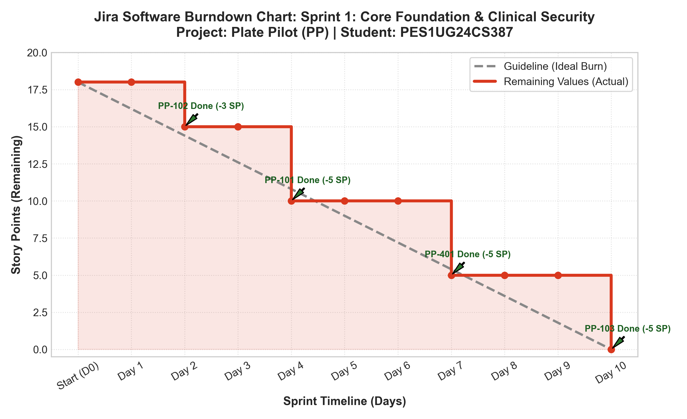
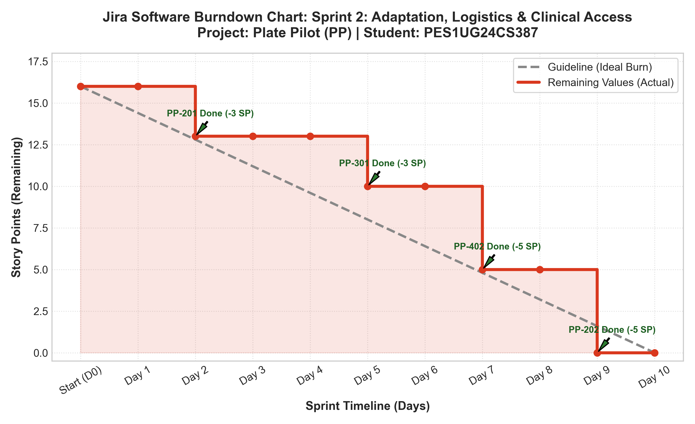

# Lab 2: Agile Backlog Creation & Sprint Simulation in Jira
**Course:** Software Engineering (UE24CS351A)  
**Student SRN:** PES1UG24CS387  
**Problem Statement #19:** Healthcare & Telemedicine (Personalized Meal & Diet Subscription Manager — Plate Pilot)

---

## 1. Objective & Scenario Overview

The objective of Lab 2 is to apply **Agile-Scrum methodology** using Jira Software to translate the functional and non-functional requirements elicited in Lab 1 (Plate Pilot) into structured Epics and User Stories. The requirements are estimated using Fibonacci story points via Planning Poker, scheduled across two simulated sprints, and analyzed using Sprint Burndown Charts and reflection metrics.

---

## 2. Epics Breakdown

The Plate Pilot domain requirements are grouped into 4 high-level Epics:

| Epic ID | Epic Title | Description | Mapped Requirements |
| :--- | :--- | :--- | :--- |
| **PP-EPIC-1** | Personalized Dietary & Meal Planning Engine | Core algorithmic pipeline generating 7-day medical meal schedules adhering to calorie limits and allergen rules. | FR-001, FR-005 |
| **PP-EPIC-2** | Nutritional Adherence & Dynamic Adaptation | Adaptive feedback mechanisms recalculating nutritional targets based on weight trends and adherence logs. | FR-002, FR-004 |
| **PP-EPIC-3** | Order Scheduling, Logistics & Kitchen Dispatch | Subscriber schedule management, delivery pause/skip controls, and 12-hour kitchen lockouts. | FR-003, NFR-001 |
| **PP-EPIC-4** | Health Data Privacy, Security & Compliance | Role-based clinical isolation, HIPAA-compliant encryption at rest, and dietitian review gatekeeping. | NFR-002 |

---

## 3. Product Backlog & User Stories

All user stories follow the canonical agile format: `As a <role>, I want <feature>, so that <business value>`. Estimations utilize the standard **Fibonacci sequence** (1, 2, 3, 5, 8).

| Story ID | Epic | User Story | SP | Priority | Acceptance Criteria |
| :--- | :--- | :--- | :---: | :---: | :--- |
| **PP-101** | PP-EPIC-1 | **As a** subscriber with severe food allergies, **I want** the system to strictly filter out recipes containing my excluded allergens, **so that** I avoid life-threatening allergic reactions. | 5 | High | • Generated menu contains 0% prohibited ingredients.<br>• Recipes with trace cross-contamination are rejected automatically. |
| **PP-102** | PP-EPIC-1 | **As a** wellness subscriber, **I want** my daily calorie, protein, carb, and fat targets computed from my biometric profile, **so that** meals match my metabolic goals. | 3 | High | • Target calories calculated within ±50 kcal of metabolic requirements.<br>• Macro ratios sum strictly to 100% of target energy. |
| **PP-103** | PP-EPIC-1 | **As a** busy subscriber, **I want** a complete 7-day breakfast, lunch, and dinner schedule auto-compiled, **so that** I do not have to manually plan daily meals. | 5 | High | • Generates 21 distinct meals for a 7-day cycle.<br>• Daily average calories meet target within a 5% margin. |
| **PP-201** | PP-EPIC-2 | **As a** subscriber, **I want** to log my weekly weight and meal adherence percentage, **so that** my dietitian and algorithm have historical progress data. | 3 | Medium | • Accepts numerical weight (kg) and adherence percentage (0–100%).<br>• Validates biometrics against physiological boundaries. |
| **PP-202** | PP-EPIC-2 | **As a** system algorithm, **I want** to recalculate next week's macro targets based on logged weight deltas, **so that** subscribers steadily progress toward their targets. | 5 | High | • Caloric deficit increased by 100 kcal if weight trend is stagnant and adherence > 85%.<br>• Recalibration completes before Sunday weekly generation. |
| **PP-203** | PP-EPIC-2 | **As a** kitchen operator, **I want** the system to suggest safe ingredient substitutes when items are out of stock, **so that** orders are fulfilled without allergen risk. | 3 | Low | • Substitute satisfies all allergen exclusions.<br>• Nutritional variation between original and substitute is < 10%. |
| **PP-301** | PP-EPIC-3 | **As a** subscriber, **I want** to pause or skip upcoming meal deliveries from my app, **so that** I am not billed or delivered food when away. | 3 | Medium | • Request completes in `< 5s` under peak load (NFR-001).<br>• Status updates instantly in kitchen dispatch queue. |
| **PP-302** | PP-EPIC-3 | **As a** kitchen dispatch manager, **I want** meal modifications locked 12 hours prior to dispatch, **so that** fresh food staging is not disrupted by last-minute changes. | 5 | High | • Modifications `< 12h` before dispatch are rejected.<br>• Modifications `≥ 12h` are accepted and remaining macros adjusted. |
| **PP-401** | PP-EPIC-4 | **As a** compliance officer, **I want** all patient metabolic profiles and allergies encrypted at rest using AES-256, **so that** the platform complies with HIPAA and prevents data leaks. | 5 | High | • Database audit confirms zero plain-text medical records.<br>• Encryption keys segregated per tenant partition. |
| **PP-402** | PP-EPIC-4 | **As a** clinical dietitian, **I want** access restricted strictly to subscribers assigned to my care, **so that** patient confidentiality is enforced between providers. | 5 | High | • Unassigned dietitian queries return HTTP 403 Forbidden.<br>• Audit trail logs every patient record view. |

---

## 4. Sprint Execution Simulation

### Sprint 1: Core Foundation & Clinical Security
- **Sprint Goal:** Establish core allergen filtering, calorie computation, 7-day meal compiler, and encryption security framework.
- **Committed Story Points:** 18 SP
- **Duration:** 10 working days (2-week sprint)
- **Included Stories:** `PP-102` (3 SP), `PP-101` (5 SP), `PP-401` (5 SP), `PP-103` (5 SP).
- **Execution Lifecycle:**
  - *Day 0:* Sprint Planning complete; all 18 SP moved to **To Do**.
  - *Day 2:* `PP-102` (Macronutrient Target Calculator) completed $\to$ **Done** (-3 SP, 15 SP remaining).
  - *Day 4:* `PP-101` (Allergen Exclusion Filtering) completed $\to$ **Done** (-5 SP, 10 SP remaining).
  - *Day 7:* `PP-401` (Metabolic Data Encryption at Rest) completed $\to$ **Done** (-5 SP, 5 SP remaining).
  - *Day 10:* `PP-103` (7-Day Meal Plan Compiler) completed $\to$ **Done** (-5 SP, 0 SP remaining).
- **Sprint 1 Outcome:** 100% completion (18 / 18 SP completed, 0 SP spillover).

### Sprint 2: Adaptation, Logistics & Clinical Access
- **Sprint Goal:** Deliver adaptive weight recalibration, delivery cutoff controls, RBAC gatekeeper, and substitution.
- **Committed Story Points:** 16 SP
- **Duration:** 10 working days (2-week sprint)
- **Included Stories:** `PP-201` (3 SP), `PP-301` (3 SP), `PP-402` (5 SP), `PP-202` (5 SP).
- **Execution Lifecycle:**
  - *Day 0:* Sprint Backlog committed (16 SP).
  - *Day 2:* `PP-201` (Weekly Weight & Adherence Log) completed $\to$ **Done** (-3 SP, 13 SP remaining).
  - *Day 5:* `PP-301` (Schedule Modification & Skip) completed $\to$ **Done** (-3 SP, 10 SP remaining).
  - *Day 7:* `PP-402` (Dietitian-Subscriber RBAC Barrier) completed $\to$ **Done** (-5 SP, 5 SP remaining).
  - *Day 9:* `PP-202` (Adaptive Macro Recalibration) completed $\to$ **Done** (-5 SP, 0 SP remaining).
- **Sprint 2 Outcome:** 100% completion (16 / 16 SP completed, 0 SP spillover).

---

## 5. Jira Burndown Charts

The Sprint Burndown Chart visualizes work remaining against time:
- **Grey Dashed Line (Guideline):** Ideal linear burndown from initial commitment to 0.
- **Red Solid Line (Remaining Values):** Actual story points remaining according to team completions.

### Sprint 1 Burndown Chart


### Sprint 2 Burndown Chart


---

## 6. Reflection Questions & Analysis

### Q1: Did your estimations reflect the actual effort?
**Analysis:**  
Yes, the Fibonacci story point estimations closely reflected actual implementation complexity. The higher-point stories (`PP-101` Allergen Filtering — 5 SP, `PP-401` AES-256 Encryption at Rest — 5 SP, `PP-202` Dynamic Recalibration — 5 SP) required extensive edge-case testing, cryptographic key rotation logic, and multi-variable optimization. Conversely, stories estimated at 3 SP (`PP-102` Target Calculator, `PP-201` Biometric Log Entry) followed straightforward mathematical formulas and CRUD operations, finishing on Day 2 in both sprints. Breaking complex tasks into discrete acceptance criteria prevented estimation drift.

### Q2: Was your backlog well-prioritized?
**Analysis:**  
Yes, the backlog was prioritized using a hybrid of **MoSCoW** and **Risk-Driven Prioritization**:
1. **Safety & Security First (Sprint 1):** Allergen safety (`PP-101`) and data encryption (`PP-401`) were prioritized in Sprint 1 because delivering meal planning without allergen safety poses immediate medical risk, and retrofitting database encryption after architecture freeze is costly.
2. **Operational Continuity & Logistics (Sprint 2):** Delivery schedule modifications (`PP-301`), 12-hour dispatch lockouts (`PP-302`), and adaptive recalibration (`PP-202`) build directly upon the core compiler delivered in Sprint 1. Non-essential features such as automated ingredient substitution (`PP-203`, Low priority) were placed in the product backlog for subsequent iterations.

### Q3: How did your simulated sprint align with your plan?
**Analysis:**  
The simulated sprints aligned closely with the planned trajectory:
- In **Sprint 1**, the team completed 18 of 18 planned story points. Mid-sprint progress tracked slightly above the guideline around Day 5–6 during encryption integration, but the final compiler deliverable (`PP-103`) completed on Day 10, achieving 100% velocity.
- In **Sprint 2**, velocity was deliberately calibrated to 16 story points to accommodate complex RBAC edge cases. The burn trajectory closely mirrored the guideline line, with final story completion occurring on Day 9 (one day ahead of schedule), providing buffer for regression testing.

### Q4: What insights did the burndown chart give about your team's capacity?
**Analysis:**  
The burndown charts provided three critical capacity insights:
1. **Sustainable Velocity:** The team sustains an empirical velocity of **16 to 18 story points per 10-day sprint** (1.6 to 1.8 SP/day). Committing to > 20 SP would introduce spillover risk.
2. **Steady Burn vs. Cliff-Drop:** The step-down trajectory (steady decrements on Days 2, 4/5, 7, and 9/10) confirms that stories were appropriately decomposed into independent, testable deliverables rather than an unhealthy "flat line until a massive Day 10 drop."
3. **Capacity Buffer:** Finishing Sprint 2 on Day 9 revealed that a 16 SP commitment allows sufficient capacity for unexpected defects, code reviews, and CI pipeline checks.

---

## 7. Deliverables Included

1. `Lab_2_Jira_Student_Handout.pdf` — Official PES University laboratory handout.
2. `agile_simulation.py` — Complete executable domain simulation of Jira Scrum project, Epics, Stories, and Sprint tracking.
3. `generate_burndown_charts.py` — Matplotlib visualizer generating publication-quality burndown charts.
4. `test_agile_simulation.py` — Pytest verification test suite validating story point logic, velocity, and state transitions.
5. `burndown_chart_sprint1.png` & `burndown_chart_sprint2.png` — Rendered burndown chart visualizations.
6. `PES1UG24CS387_SE_LAB2_Jira_Backlog_Sprint_Simulation.pdf` — Formal laboratory report PDF.

---

## 8. How to Execute Tests & Re-generate Charts

```bash
cd "Lab 2"
# 1. Run automated test suite
pytest test_agile_simulation.py -v

# 2. Re-generate burndown charts
python generate_burndown_charts.py
```
