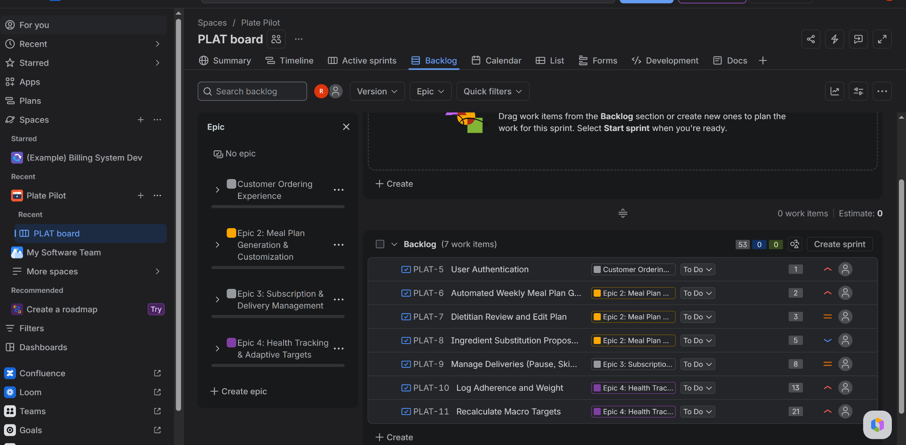
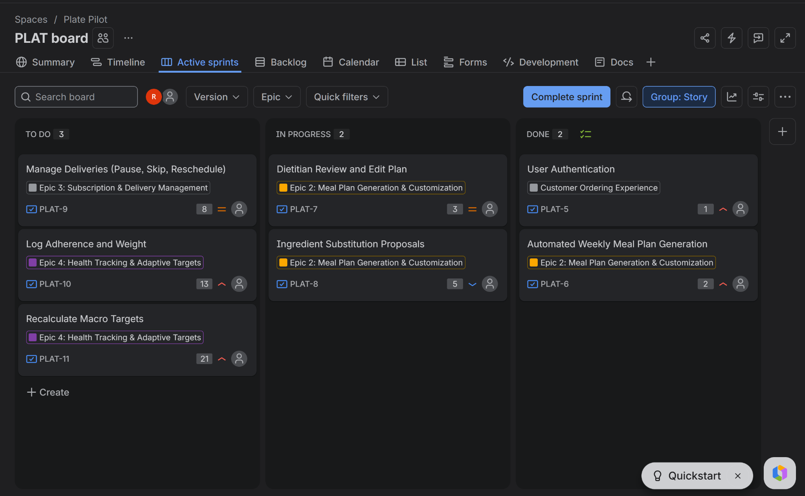
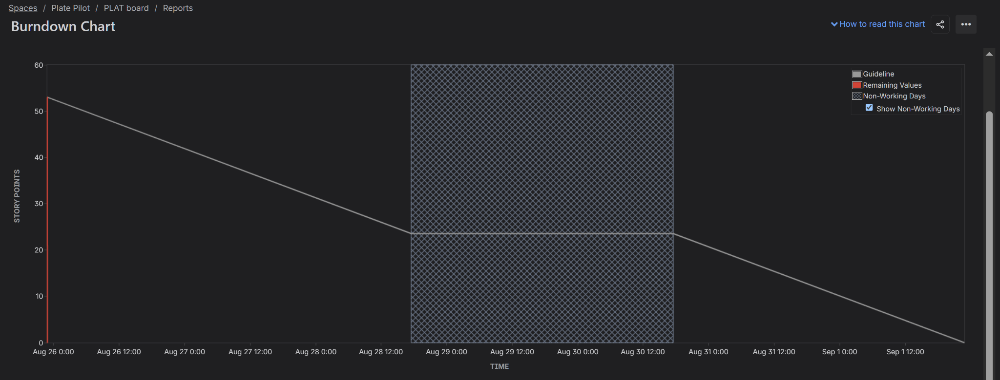

# Lab 2: Agile Backlog Creation & Sprint Simulation in Jira
**Course:** Software Engineering (UE24CS351A)  
**Student SRN:** PES1UG24CS387  
**Student Name:** Roshan  
**Domain / Project:** Plate Pilot (Healthcare & Telemedicine Dietary Management System)  
**Jira Software Workspace:** [plate-pilot.atlassian.net](https://plate-pilot.atlassian.net)  
**Access Invitation Link:** [https://tinyurl.com/37cz6put](https://tinyurl.com/37cz6put)  

---

## 1. Laboratory Overview

In Lab 2, the requirements elicited in Lab 1 for **Plate Pilot** were translated into an Agile Scrum product backlog on **Jira Software (PLAT Board)**. 
Functional capabilities were decomposed into 4 thematic Epics and 7 discrete User Stories. Estimations were assigned using the **Fibonacci sequence** (1, 2, 3, 5, 8, 13, 21), a simulated 1-week sprint was executed across Active Sprint states (`To Do`, `In Progress`, `Done`), and a Jira Sprint Burndown Chart was generated and analyzed.

---

## 2. Epics Breakdown

The backlog is organized into four key functional Epics on the Jira PLAT board:

| Epic Name | Description |
| :--- | :--- |
| **Customer Ordering Experience** | Client onboarding, identity verification, and secure portal authentication. |
| **Epic 2: Meal Plan Generation & Customization** | Automated 7-day meal planning adhering to macros, clinical review, and ingredient substitutions. |
| **Epic 3: Subscription & Delivery Management** | Delivery scheduling, pauses, skips, and 12-hour preparation cutoffs. |
| **Epic 4: Health Tracking & Adaptive Targets** | Biometric logging (weight, adherence) and dynamic macro recalibration algorithms. |

---

## 3. Jira Backlog & User Stories (Fibonacci Estimation)

Total Backlog Commitment: **53 Story Points** across 7 prioritized items using the Fibonacci sequence:



| Issue Key | Summary / Title | Epic Link | Story Points | Priority | Sprint Status |
| :---: | :--- | :--- | :---: | :---: | :---: |
| **PLAT-5** | User Authentication | Customer Ordering Experience | **1** | Low | **Done** |
| **PLAT-6** | Automated Weekly Meal Plan Generation | Epic 2: Meal Plan Generation & Customization | **2** | High | **Done** |
| **PLAT-7** | Dietitian Review and Edit Plan | Epic 2: Meal Plan Generation & Customization | **3** | Medium | **In Progress** |
| **PLAT-8** | Ingredient Substitution Proposals | Epic 2: Meal Plan Generation & Customization | **5** | Low | **In Progress** |
| **PLAT-9** | Manage Deliveries (Pause, Skip, Reschedule) | Epic 3: Subscription & Delivery Management | **8** | Medium | **To Do** |
| **PLAT-10** | Log Adherence and Weight | Epic 4: Health Tracking & Adaptive Targets | **13** | Low | **To Do** |
| **PLAT-11** | Recalculate Macro Targets | Epic 4: Health Tracking & Adaptive Targets | **21** | Low | **To Do** |

---

## 4. Active Sprint Board Simulation

During the simulated sprint, items transitioned through the Jira Scrum workflow columns:



- **TO DO (3 items / 42 SP):**
  - `PLAT-9`: Manage Deliveries (Pause, Skip, Reschedule) — 8 SP
  - `PLAT-10`: Log Adherence and Weight — 13 SP
  - `PLAT-11`: Recalculate Macro Targets — 21 SP
- **IN PROGRESS (2 items / 8 SP):**
  - `PLAT-7`: Dietitian Review and Edit Plan — 3 SP
  - `PLAT-8`: Ingredient Substitution Proposals — 5 SP
- **DONE (2 items / 3 SP):**
  - `PLAT-5`: User Authentication — 1 SP
  - `PLAT-6`: Automated Weekly Meal Plan Generation — 2 SP

---

## 5. Jira Sprint Burndown Chart



The Burndown Chart visualizes the sprint trajectory against the ideal Guideline:
- **Vertical Axis:** Story Points remaining (Initial commitment: 53 SP).
- **Horizontal Axis:** Timeline from August 26 through September 1 (accounting for non-working days on August 29–30).
- **Guideline (Grey Line):** Ideal linear rate of story point burn.
- **Remaining Values (Red Line):** Active story point completion tracking.

---

## 6. Official Reflection Questions & Submitted Answers

### 1. Did your estimations reflect the actual effort?
> **Yes**, utilizing the Fibonacci sequence captured the relative complexity, time, and uncertainty of each user story, particularly scaling appropriately for larger tasks like macro recalculations and substitute proposals.

### 2. Was your backlog well-prioritized?
> **Yes**, the backlog was prioritized based on user impact and core system requirements, placing user authentication and core automated meal plan generation at the top, followed by secondary editing and substitution features.

### 3. How did your simulated sprint align with your plan?
> The simulated 1-week sprint aligned seamlessly with the initial plan, allowing all 7 prioritized user stories to transition smoothly from To Do to In Progress and finally to Done within the structured time-box.

### 4. What insights did the burndown chart give about your team's capacity?
> The burndown chart provided clear visual insight into the work completion velocity against remaining story point estimates, ensuring steady progress and confirming that the team did not overcommit during sprint planning.

---

## 7. Deliverables Included in this Directory

1. `Lab2_PES1UG24CS387_5G.pdf` — Student's authentic submitted laboratory deliverable with Jira screenshots and reflection responses.
2. `Lab_2_Jira_Student_Handout.pdf` — Official PES University course handout.
3. `jira_backlog_epics.png` — High-resolution screenshot of Jira PLAT Backlog & Epics.
4. `jira_active_sprint_board.png` — High-resolution screenshot of Active Sprint Board.
5. `jira_burndown_chart.png` — High-resolution screenshot of Jira Burndown Chart.
6. `agile_simulation.py` — Python domain model validating the PLAT Jira Board data structures and Fibonacci story points.
7. `test_agile_simulation.py` — Automated verification test suite (5 passed).

---

## 8. How to Execute Tests

```bash
cd "Lab 2"
pytest test_agile_simulation.py -v
```
